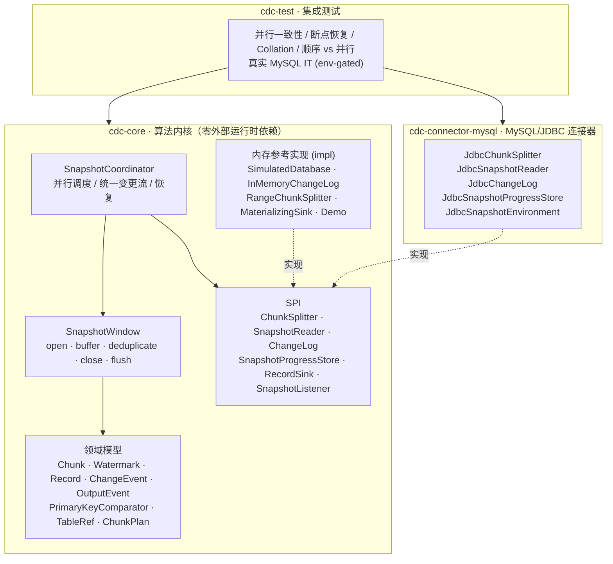
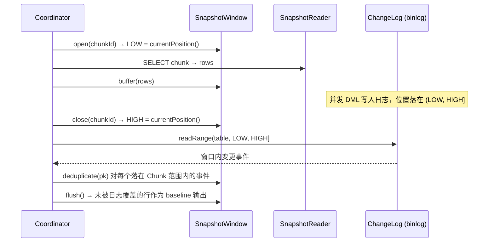

# Incremental Snapshot CDC

[](https://github.com/edidada/incremental-snapshot-cdc/actions/workflows/ci.yml)
[](https://openjdk.org/)
[](https://maven.apache.org/)
[](#模块划分)

一个**可运行、可恢复、可并行**的 DBLog 风格增量快照（Incremental Snapshot / 无锁全量+增量）CDC 引擎参考实现。

与"最小可运行版本"不同，本项目按工业级要求落地了：并行分块、水位线窗口去重、Checkpoint 断点恢复、**持久化分块计划**、字符串排序规则（collation）一致性、真实 JDBC/MySQL 连接器、分层测试体系与 GitHub Actions CI。核心算法与具体数据库完全解耦。

---

## 目录

- [项目定位](#项目定位)
- [背景：Debezium 与 Flink CDC 的差异](#背景debezium-与-flink-cdc-的差异)
- [架构](#架构)
- [模块划分](#模块划分)
- [核心算法](#核心算法)
- [快速开始](#快速开始)
- [编程使用](#编程使用)
- [配置参考](#配置参考)
- [SPI 一览](#spi-一览)
- [测试策略](#测试策略)
- [CI / GitHub Actions](#ci--github-actions)
- [设计取舍与已知边界](#设计取舍与已知边界)
- [Roadmap](#roadmap)

---

## 项目定位

增量快照要解决的问题：**在不锁表、不中断增量日志流的前提下，为一张大表做全量同步，并保证"全量 + 期间并发变更"合并后的最终一致性。**

本项目实现的是算法内核与连接器骨架，目标不是替换 Debezium / Flink CDC，而是把论文与工程实践里最容易踩坑的部分（窗口去重、并行窗口的统一、恢复时的分块漂移、字符串 collation）做成**可读、可测、可验证**的代码。

代码里每一个关键决策都有对应测试：`SnapshotWindowTest` 验证 DBLog 窗口，`ParallelSnapshotConsistencyTest` 用 1000 行 + 240 个并发变更验证最终一致性，`CheckpointRecoveryTest` 验证崩溃恢复，`CollationBoundaryTest` 复现 `utf8mb4_general_ci` 的经典缺陷。

---

## 背景：Debezium 与 Flink CDC 的差异

两者在增量快照上的核心差异，可以概括为一句话：**Debezium 的增量快照是为 Kafka Connect 单线程模型设计的"顺序流式修正"，而 Flink CDC 是为分布式并行计算设计的"分块并行修正"。** 虽然都受 DBLog 论文启发，工程实现路径截然不同。

| 维度 | Debezium | Flink CDC |
| --- | --- | --- |
| **并行度与执行模型** | 表级顺序处理，按块大小（默认 1024 行）逐块依次快照，受限于 Kafka Connect 单任务模型 | 天生并行，Chunk 可分配给多个 Source 并行读取，靠水平扩展缩短全量耗时 |
| **冲突解决时机** | "缓冲 + 丢弃"：窗口内把快照行放内存缓冲，日志里出现同主键变更就丢弃缓冲行，窗口关闭后刷出剩余行 | "回放 + 覆盖"：Chunk 读完后主动回放 `(LOW, HIGH]` 的 Binlog，用变更覆盖/修正快照缓冲，合并后再输出 |
| **断点恢复粒度** | 从上一个已完成块继续，进度（表列表、最大主键、最后事件主键）写在 offset 里 | 借助 Checkpoint 做到 Chunk 级；**必须开启 Checkpoint**，否则重启只读全量 |
| **触发与运维** | 通过源库 signal 表按需触发，运行中可动态发起快照 | 作业启动时按配置自动执行，同步范围与作业生命周期绑定更紧 |
| **设计哲学** | 单进程模型下"连续窗口"很好用 | 多进程/分布式下需自己控制 Chunk 分配、并行读取与水位线，才能融入 Checkpoint 体系 |

一个关键结论：**顺序窗口可以按时间"平铺"，并行窗口会互相重叠，因此并行引擎不能简单把每个 Chunk 的窗口事件并集输出，必须引入一条统一的有序变更流。** 这正是本实现 `SnapshotCoordinator` 的做法（见下节）。

---

## 架构



**依赖方向**：`cdc-core` 不依赖任何数据库；`cdc-connector-mysql` 只依赖 `cdc-core` 的 SPI；`cdc-test` 做跨模块验证。核心模块编译产物仅依赖 JDK，可直接 `java -cp` 运行。

---

## 模块划分

| 模块 | 职责 | 关键内容 |
| --- | --- | --- |
| `cdc-core` | 算法骨架，不依赖具体数据库 | `Chunk` / `Watermark` / `SnapshotWindow`（窗口内去重）/ `ChunkSplitter` 接口 / `SnapshotProgressStore` 接口 / `PrimaryKeyComparator` / `SnapshotCoordinator` / 内存参考实现 / 可运行 Demo |
| `cdc-connector-mysql` | MySQL 具体实现 | 采样式 `JdbcChunkSplitter`、分块范围 `SELECT` 的 `JdbcSnapshotReader`、changelog 表 `JdbcChangeLog`、持久化 `JdbcSnapshotProgressStore`、装配入口 `JdbcSnapshotEnvironment` |
| `cdc-test` | 集成测试与模拟 | 并发写入、断点恢复、字符串 collation 边界、顺序/并行一致性、环境开关控制的真实 MySQL IT |

核心接口（借鉴 DBLog 的抽象层次，不照搬 Debezium）：

```java
// cdc-core / spi / SnapshotWindow.java
public interface SnapshotWindow {
    void open(String chunkId);              // 记录 LOW 位点
    void buffer(Record row);                // 缓存快照行
    void deduplicate(Object primaryKey);    // 窗口内收到 Binlog 事件时移除对应主键
    void close(String chunkId);             // 记录 HIGH 位点
    List<ChangeEvent> replay();             // 回放 (LOW, HIGH] 区间
    List<Record> flush();                   // 输出剩余未被覆盖的行
    Watermark watermark();
}
```

`cdc-core` 只负责"什么时候开窗、关窗、去重、刷出"，具体 `SELECT` 怎么执行、Binlog 怎么读由连接器实现。

---

## 核心算法

### 1. 单 Chunk 的 DBLog 窗口



日志优先（log wins）：窗口内被变更过的主键，其快照值被丢弃，由变更流提供最新值。

### 2. 为什么并行时要用"统一变更流"

顺序分块时，各窗口在**时间上不重叠**，把每个窗口的日志事件并集输出即可覆盖整个区间（Debezium 的做法）。但并行分块时窗口互相重叠：

- 若每个 Chunk 只输出自己范围内的事件，那么"某个 Chunk 窗口已关闭后、发生在另一个 Chunk 窗口内、但主键属于前者"的事件会**永久丢失**；
- 若把所有窗口事件简单并集，又会**重复**。

因此 `SnapshotCoordinator` 采用 Flink CDC 式方案：

1. 每个 Chunk 并行执行窗口算法，只输出**去重后的 baseline 行**（位置标记为各自的 LOW，优先级低于流事件），并在完成时立即写入 sink + Checkpoint；
2. 所有 Chunk 完成后，从**全局 changelog** 按位置顺序回放 `(snapshotStart, snapshotEnd]` 的全部事件；
3. 下游按主键 last-wins 物化。由于 baseline 反映其 LOW 时刻的一致状态，而所有变更事件位置更大、优先级更高，最终状态必然等于 `snapshotEnd` 时刻的源表状态。

`parallelism = 1` 即退化为 Debezium 式顺序模型，两种模式输出完全一致（有测试保证）。

### 3. 断点恢复：持久化分块计划

这是最容易被忽略的坑。恢复时如果**用当前主键集合重新分块**，而崩溃前后发生过 INSERT/DELETE，主键分布会变化，Chunk 边界随之漂移，已完成 Chunk 与新分块的对应关系错位，最终**静默丢行或重复**（`CheckpointRecoveryTest` 精确复现了这个 bug）。

因此引擎在快照开始时把 **ChunkPlan（边界 + 原始 `snapshotStart`）持久化**，恢复时复用同一份计划，跳过已完成 Chunk，并从原始 `snapshotStart` 继续回放统一变更流。这与 Flink CDC 把 chunk ranges 放进 operator state 是同一个思路。`InMemoryProgressStore` 与 `JdbcSnapshotProgressStore` 都实现了该持久化。

### 4. 字符串 Collation 一致性

数据库 `ORDER BY` 用列排序规则（如 `utf8mb4_general_ci` 大小写不敏感），而 Java `String.compareTo` 是二进制序。若**边界计算**与**范围求值 / 窗口去重**使用不同顺序，分块就不再是精确划分。

本实现把 `PrimaryKeyComparator` 作为一等概念注入 `TableRef`，分块、范围判定、窗口缓冲（`TreeMap`）、结果物化全部共用同一比较器。`TableRef.caseInsensitiveString(...)` 可直接模拟 `utf8mb4_general_ci`；`CollationBoundaryTest` 同时给出"一致 → 精确划分"和"二进制序 vs ci → 重复/丢失"的对照验证。

---

## 快速开始

环境：JDK 17+、Maven 3.9+。

```bash
# 编译 + 全量测试（多模块 reactor）
mvn -B -ntp clean verify

# 运行独立 Demo：200 行的表 + 并行快照 + 窗口内并发 DML + 自校验
java -cp cdc-core/target/classes org.example.cdc.core.demo.IncrementalSnapshotDemo
```

Demo 成功时输出：

```
=== Incremental Snapshot CDC :: demo ===
  [writer] concurrent DML fired during Chunk{orders#00000 [null .. 17)}
  SnapshotResult{orders, window=(0, 4], distinctKeys=200, ...}
  rows materialized : 200
  changelog events  : 203
DEMO OK - final state is consistent under concurrent writes.
```

`cdc-core` 打出的 jar 自带 `Main-Class`，也可 `java -jar cdc-core/target/cdc-core-1.0.0-SNAPSHOT.jar`。

---

## 编程使用

### 内存参考实现（零依赖，适合算法验证 / 基准测试）

```java
TableRef table = TableRef.numeric("orders", "id");
SimulatedDatabase db = new SimulatedDatabase(table);
for (long id = 1; id <= 10_000; id++) {
    db.seed(id, Record.row("id", id, "amount", id * 10L, "status", "NEW"));
}
// 可选：在 selectHook 里注入并发 DML，模拟全量期间的写入
db.setSelectHook(chunk -> db.update(3L,
        Record.row("id", 3L, "amount", 999L, "status", "UPDATED")));

MaterializingSink sink = new MaterializingSink(table.order());
SnapshotConfig config = new SnapshotConfig()
        .setChunkSize(1024)
        .setParallelism(8)
        .setMaxRetries(3);

SnapshotResult result = db.coordinator(config, sink, SnapshotListener.noop()).execute();
NavigableMap<Object, Record> finalState = sink.rows();   // == db.currentRows()
```

### 真实 MySQL / JDBC

```java
MysqlDataSource ds = new MysqlDataSource();
ds.setUrl("jdbc:mysql://localhost:3306/app");
ds.setUser("cdc");
ds.setPassword("...");

TableRef table = TableRef.numeric("orders", "id");
JdbcSnapshotEnvironment env = new JdbcSnapshotEnvironment(ds, table);
env.initializeSchema();                       // 建 progress / changelog 表

SnapshotResult result = env.coordinator(config, sink, SnapshotListener.noop())
                           .execute();
```

> 生产环境中 DML 由业务写入、binlog 由 `mysql-binlog-connector-java` 之类的客户端灌入 `ChangeLog`；仓库提供的 `JdbcChangeLog` 是 changelog-table 适配器（也便于在嵌入式数据库上做端到端测试），`JdbcSnapshotEnvironment.apply(...)` 则把两者拼成一个可直接运行的闭环。

---

## 配置参考

`SnapshotConfig`：

| 参数 | 默认值 | 说明 |
| --- | --- | --- |
| `chunkSize` | `1024` | 每个 Chunk 的最大行数 |
| `parallelism` | `4` | Chunk 工作线程数；`1` 为顺序模型，`>1` 为并行模型 |
| `maxRetries` | `3` | 单个 Chunk 读取失败的重试次数 |
| `retryBackoffMillis` | `25` | 重试退避 |
| `resumeFromCheckpoint` | `true` | 是否从已持久化进度/计划恢复 |

`TableRef` 工厂：

| 工厂 | 排序语义 | 适用 |
| --- | --- | --- |
| `TableRef.numeric(t, pk)` | `BigDecimal` 数值序 | 整型 / 数值主键 |
| `TableRef.binaryString(t, pk)` | `String.compareTo` | `utf8mb4_bin` 等二进制排序 |
| `TableRef.caseInsensitiveString(t, pk)` | 大小写不敏感 + 二进制兜底 | `utf8mb4_general_ci` 等 |

---

## SPI 一览

| 接口 | 职责 | 实现 |
| --- | --- | --- |
| `ChunkSplitter` | 把表切成主键范围 | `RangeChunkSplitter`（内存）、`JdbcChunkSplitter`（采样 `ORDER BY pk LIMIT 1 OFFSET n`） |
| `SnapshotReader` | 执行分块 `SELECT` | `InMemorySnapshotReader`、`JdbcSnapshotReader` |
| `ChangeLog` | 提供位点与 `(low, high]` 回放 | `InMemoryChangeLog`、`JdbcChangeLog` |
| `SnapshotProgressStore` | 持久化进度 + 分块计划 | `InMemoryProgressStore`、`JdbcSnapshotProgressStore` |
| `RecordSink` | 接收归一化变更流 | `MaterializingSink`（last-wins 物化） |
| `SnapshotWindow` | DBLog 窗口去重 | `DefaultSnapshotWindow` |
| `SnapshotListener` | 可观测性 / 故障注入 | 默认 no-op，测试用它模拟崩溃 |

---

## 测试策略

增量快照的难点在于**并发**和**边界**，测试覆盖这两个维度（共 31 个确定性用例 + 1 个环境开关用例）：

**单元测试（`cdc-core`）**
- `PrimaryKeyComparatorTest`：数值 / 二进制 / 大小写不敏感序
- `SnapshotWindowTest`：`open → buffer → deduplicate → close → replay → flush` 的窗口语义与位点
- `ChunkTest`、`RangeChunkSplitterTest`：半开区间、精确划分、稳定 chunk id
- `SnapshotCoordinatorTest`：全量一致性、窗口内并发 DML、空表 + 并发 INSERT、禁用恢复

**JDBC 测试（`cdc-connector-mysql`，H2 `MODE=MySQL`）**
- 采样分块精确划分、全量快照、changelog 窗口回放 + 进度/计划持久化 round-trip、并发 DML 端到端

**集成测试（`cdc-test`）**
- `ParallelSnapshotConsistencyTest`：1000 行、8 并行、4 写线程、240 个并发变更，验证最终一致与 exactly-once
- `CheckpointRecoveryTest`：崩溃 → 复用同一 sink / 进度 / 计划恢复，验证已完成 Chunk 不重读、数据完整
- `CollationBoundaryTest`：`utf8mb4_general_ci` 对照实验，验证正确/错误比较器的划分结果
- `SequentialVsParallelTest`：`parallelism=1` 与 `parallelism=8` 输出一致
- `MysqlIntegrationTest`：**环境开关**（`MYSQL_URL`）控制的真实 MySQL 8 端到端测试；普通 CI 跳过，手动 workflow 用 `services: mysql` 运行

> 并发写入通过 `selectHook` 注入到 Chunk 的 SELECT 窗口内，是**确定性**的，不依赖 sleep / 线程时序，因此 CI 不会 flaky。

---

## CI / GitHub Actions

| Workflow | 触发 | 内容 |
| --- | --- | --- |
| `ci.yml` → `build` | push / PR / 手动 | JDK 17 + 21 矩阵，`mvn -B -ntp clean verify`，运行 Demo 自校验，上传 surefire 报告 |
| `ci.yml` → `mysql-integration` | 仅 `workflow_dispatch` | `services: mysql:8.0`，设置 `MYSQL_URL` 后运行真实 MySQL IT |

`build` 不依赖任何外部服务（核心零外部运行时依赖，JDBC 测试用嵌入式 H2），因此默认构建快速且稳定。

---

## 设计取舍与已知边界

- **统一变更流**：为保证并行正确性，所有 binlog 事件由一条全局有序流回放，而不是逐窗口并集；这是 Flink CDC 式取舍。
- **分块计划持久化**：恢复时复用原始边界，不用当前主键集合重新分块——否则边界漂移会静默丢行/重复。
- **零外部运行时依赖的核心**：`cdc-core` 仅用 JDK（`java.util.logging`），便于作为库嵌入、也保证 CI 可重复。
- **changelog-table 适配器**：`JdbcChangeLog` 面向"DML 落到日志表"的模式；直连 binlog 流只需实现同一个 `ChangeLog` SPI。
- **边界**：当前实现单表单列主键；组合主键、DDL 变更、跨库事务、精确 exactly-once 到外部存储（需幂等 sink 或两阶段提交）、`snapshotEnd` 之后的持续流式阶段，留待 Roadmap。字符串 collation 目前提供 `binary` / `case-insensitive` 两种，特殊 locale 排序需自定义 `PrimaryKeyComparator`。

---

## Roadmap

- [ ] 组合主键与无主键表的分块策略
- [ ] 接入 `mysql-binlog-connector-java` 的真实 binlog `ChangeLog`
- [ ] 持续流式阶段（快照完成后继续消费增量）
- [ ] 幂等 / 事务型 sink（Kafka、JDBC、Iceberg）
- [ ] JMH 基准与更大表规模压测
